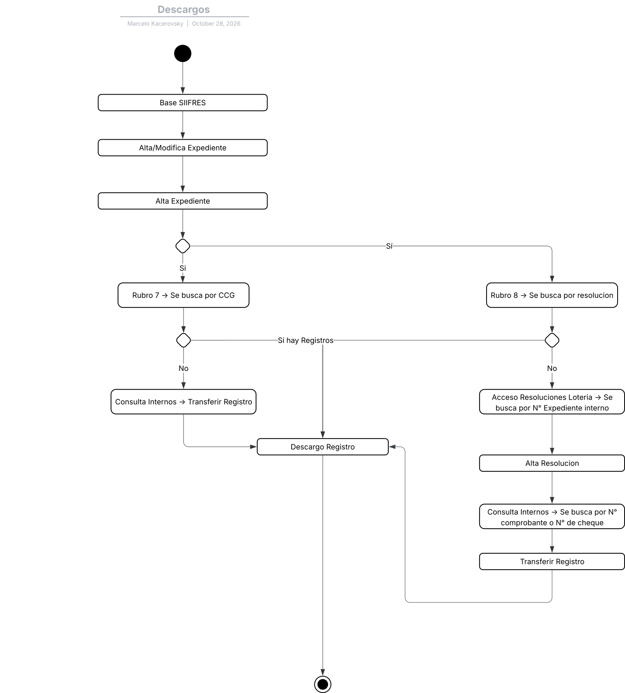
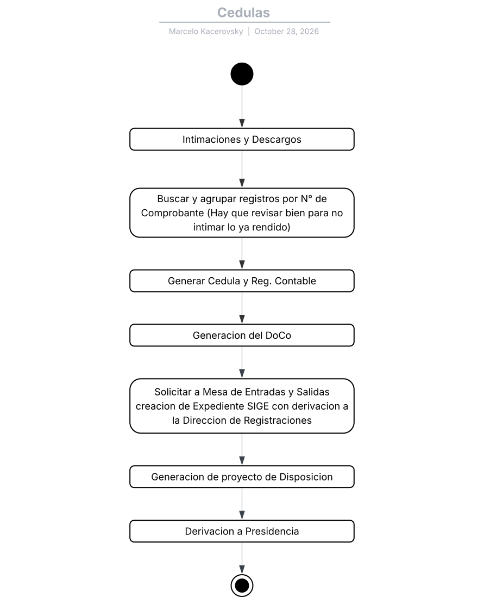
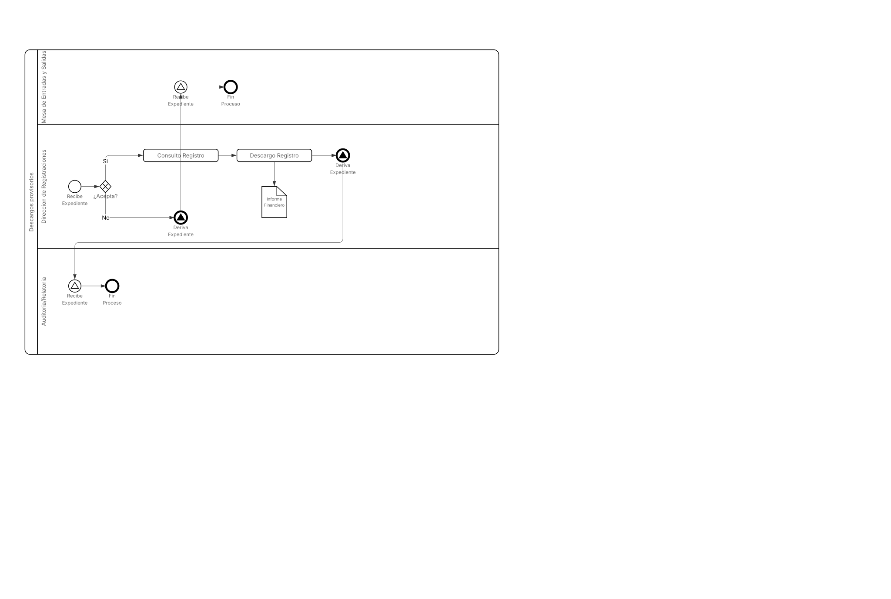
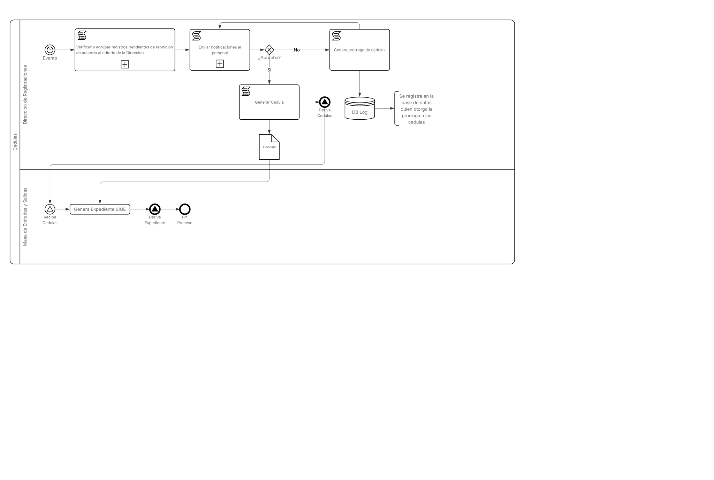

## 
SIGE-Registraciones

#### Organismo: Honorable Tribunal de Cuentas de la Provincia de Corrientes
#### Área: Dirección de Informatica
#### Director: Lic. Juan Martin Cemborain
#### Jefe de Informatica: Lic. Oscar Fernando Medrano
#### Desarrollador: Marcelo David Kacerovky

---

## Introducción

El presente proyecto consiste en el desarrollo de un nuevo sistema para la Dirección de Registraciones del Honorable Tribunal de Cuentas de Corrientes. La propuesta busca mantener las funcionalidades del sistema actualmente utilizado e incorporar mejoras orientadas a optimizar los procesos de trabajo. Entre ellas se contempla la interoperabilidad con el **SIGE (Sistema de Expedientes del Organismo)**, la automatización de determinados procesos, la incorporación de un tablero de control y la reestructuración de la base de datos.

El nuevo desarrollo tecnológico mantendrá las funcionalidades esenciales del sistema heredado e incorporará mejoras:
- Interoperabilidad: Integración directa con el SIGE (Sistema de Gestión de Expedientes).
- Optimización gerencial: Incorporación de tableros de control y automatización de procesos operativos.
- Modernización de datos: Reestructuración integral de la base de datos para optimizar la calidad de la información y agilizar los flujos de trabajo de la dirección.

---

## Requerimientos

El desarrollo del sistema se enmarca en los principios de la **modernización del Estado**, orientados a:

- Centralización y trazabilidad de la información
- Interoperabilidad con SIGE
- Gestión basada en datos confiables
- Fortalecimiento del control y la transparencia
- Mejora en la atención al ciudadano

---

## Diccionario de datos

Se presentan algunas tablas principales del nuevo Sistema en desarrollo las cuales son:
- **Record:** Tabla maestra de los registros ( Todos los Registros poseen una relación uno a uno con esta tabla la cual agrupa las propiedades en común de todos los reportes ).
- **Rendi11 Record:** Tabla del reporte RENDI11 ( Movimientos de tesorería general de la provincia ).
- **Rcoch_g2 Record:** Tabla del reporte RCOCH_G2 ( Cheques internos por transferencia ).
- **Accountability:** Tabla maestra de los descargos provisorios.

### Tabla Record

| Campo | Tipo | Long | Descripción | Llave | Valicación |
| --- | --- | --- | --- | --- | --- |
| id | BIGINT | 20 | Identificador del registro | PK | AUTOINCREMENTAL |
| origin_number | INT | 10 | Número de comprobante | | Mayor a 0 UNSIGNED |
| entry_number | INT | 10 | Número de entrada del registro (proviene del SIIF) | | UNSIGNED |
| jurisdiction_id | BIGINT | 20 | Jurisdicción vinculada | FK | NO NULO |
| cta_cte_id | BIGINT | 20 | Código de cuenta corriente | FK | NO NULO |
| funding_source_id | BIGINT | 20 | Número de fuente de financiación | FK | NO NULO |
| description | STRING | 512 | Descripción breve del registro | | NO NULO |
| report_id | BIGINT | 20 | Parte vinculada | FK | NULO |
| amount | DECIMAL | 24 | Importe | | 2 Decimales |
| observations | STRING | 1024 | Observaciones (solo se usa en caso de algún problema de importación) | | NULO |
| valid | TINYINT | 1 | Valor booleano que indica si el registro es vigente o no | | |

### Tabla Rendi11 Record

| Campo | Tipo | Long | Descripción | Llave | Valicación |
| --- | --- | --- | --- | --- | --- |
| id | BIGINT | 20 | Identificador del registro | PK | AUTOINCREMENTAL |
| exercise | INT | 10 | Ejercicio de origen | | UNSIGNED |
| payment_exercise | INT | 10 | Ejercicio de pago | | UNSIGNED |
| date | DATE | 8 | Fecha del parte | | NO NULO |
| value_date | DATE | 8 | Fecha valor (transferencias) | | NULO |
| internal_number | INT | 10 | Número interno (SIIF) | | NO NULO |
| transfer_number | BIGINT | 20 | Numero de cheque | | NULO |
| receipt_type_id | BIGINT | 20 | Tipo de comprobante | FK | NO NULO |
| beneficiary_id | BIGINT | 20 | Beneficiario | FK | NO NULO |
| entry_id | BIGINT | 20 | Partida | FK | NULO |
| category_id | BIGINT | 20 | Rubro | FK | NULO |
| record_id | BIGINT | 20 | Tabla maestra de registros | FK | NO NULO |

### Tabla Rcoch_g2 Record

| Campo | Tipo | Long | Descripción | Llave | Valicación |
| --- | --- | --- | --- | --- | --- |
| id | BIGINT | 20 | Identificador del registro | PK | AUTOINCREMENTAL |
| exercise | INT | 10 | Ejercicio de origen | | UNSIGNED |
| date | DATE | 8 | Fecha del parte | | NO NULO |
| backward_exercise | INT | 10 | Ejercicio anterior | | NO NULO |
| transfer_number | BIGINT | 20 | Numero de cheque | | NULO |
| receipt_type_id | BIGINT | 20 | Tipo de comprobante | FK | NO NULO |
| beneficiary_id | BIGINT | 20 | Beneficiario | FK | NO NULO |
| expedient_id | BIGINT | 20 | Expediente de origen (Interno de la jurisdicción) | FK | NULO |
| resolution_id | BIGINT | 20 | Resolución | FK | NULO |
| entry_id | BIGINT | 20 | Partida | FK | NULO |
| category_id | BIGINT | 20 | Rubro | FK | NULO |
| record_id | BIGINT | 20 | Tabla maestra de registros | FK | NO NULO |

### Tabla Accountability

| Campo | Tipo | Long | Descripción | Llave | Valicación |
| --- | --- | --- | --- | --- | --- |
| id | BIGINT | 20 | Identificador del registro | PK | AUTOINCREMENTAL |
| expedient_id | BIGINT | 20 | Expediente de rendición (SIGE) | FK | NO NULO |
| date | DATETIME | 12 | Fecha del descargo | | NO NULO |
| record_id | BIGINT | 20 | Relación mucho a muchos de los registros (usa una tabla intermedia) | FK | |

---

## Diagramas

### Diagrama UML

Los presentes diagramas UML representan la forma actual de trabajo en la Dirección de registraciones previo a la imprementación del nuevo sistema.

#### Descargos Provisiorios

#### Cédulas e Intimaciones

### Diagrama BPMN

Los presentes diagramas BPMN representan la nueva forma de trabajo a implementar en la Dirección de registraciones con la imprementación del nuevo sistema.

#### Descargos Provisiorios

#### Cédulas e Intimaciones

---

## Indicadores

- Optimizar los tiempos de respuesta del sistema
    - Indicador: Tiempo promedio de respuesta de las consultas habituales sobre la base de datos
    - Valor objetivo: Menor a 1,5 segundos
- Depurar y normalizar los datos históricos
    - Indicador: Porcentaje de tablas del sistema anterior consideradas necesarias que fueron migradas al nuevo sistema
    - Valor objetivo: ≥ 90 %
- Migrar las estructuras necesarias del sistema anterior
    - Indicador: Tiempo promedio de respuesta de las consultas habituales sobre la base de datos
    - Valor objetivo: ≥ 90 %
- Garantizar la escalabilidad de la nueva solución
    - Indicador: Capacidad del sistema para mantener los tiempos de respuesta objetivo ante el crecimiento del volumen de registros
    - Valor objetivo: Mantener consultas < 1,5 segundos con millones de registro

---

## Historias de Usuarios

### Operador 1
Como operadora del sistema quiero poder cambiar el color primario del sistema a un color de mi gusto.
- Criterios:
    - Mantener el color entre recargas del sistema.

### Director de Registraciones
Como director me gustaría automatizar de alguna forma el circuito de generar cédulas
- Criterios:
    - Las cédulas generadas deben ser aprobadas por el director y/o jefe de departamento.
    - Las no aprobadas deben prorrogarse por cierta cantidad de dias a definir.

### Jefe de Departamento de Programación Contable
Como jefe de departamento me gustaría que el nuevo sistema parta de una nueva estructura de las tablas para poder brindar una mejor información a las autoridades.
- Criterios:
    - Motor de base de datos con otra tecnología.
    - Reestructuración de las tablas.